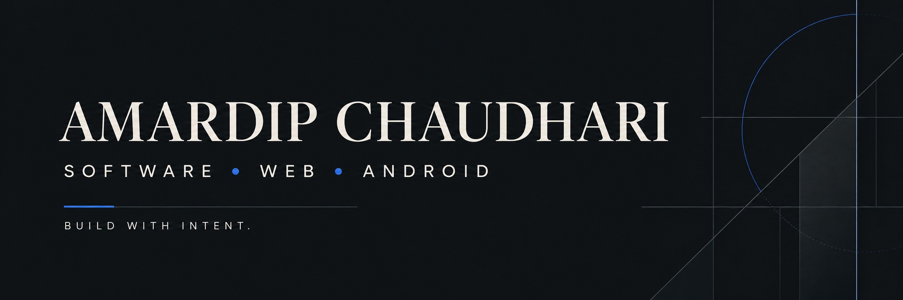

  

  <a href="https://amardipchaudhari.vercel.app">Portfolio</a> ·
  <a href="https://github.com/Amardip0?tab=repositories">Projects</a> ·
  <a href="https://www.linkedin.com/in/amardip-chaudhari-688b5432b">LinkedIn</a> ·
  <a href="mailto:amardip1109@gmail.com">Contact</a>

# Hi, I’m Amardip Chaudhari

### Full-stack developer · Android engineer · MCA student

I build practical software for the web and Android, from clean interfaces and REST-style backends to database-driven applications. I enjoy turning ideas into reliable, maintainable products and continuously improving through implementation, testing and iteration.

  
  
  

## About me

| | |
|:--|:--|
| **Currently** | Pursuing MCA at Uka Tarsadia University, Bardoli |
| **Education** | BCA graduate · 7.45 CGPA |
| **Primary focus** | Full-stack web applications and Android development |
| **Learning next** | Scalable architecture, clean code and better developer tooling |
| **Open to** | Internships, junior developer roles and collaborative projects |

## What I work with

  

## Featured work

### Custom Android Dialer

An Android dialer focused on fast contact discovery and a streamlined calling experience.

- T9 contact search and speed-dial workflows
- Minimal, OLED-inspired interface
- Practical mobile interaction patterns

`Kotlin` · `Jetpack Compose`

### Farm Inventory

A web application concept for organizing farmer and crop-related information.

- Structured information management
- Backend-connected web interface
- Database-oriented application architecture

`React` · `Express` · `MongoDB`

### News Portal

A dynamic publishing platform with content management and administrative workflows.

`PHP` · `MySQL`

### Blood Donation System

A database-backed application concept for donor information and blood-donation coordination.

`PHP` · `MySQL`

### Android Music Player

A mobile project focused on Android interface development and playback functionality.

`Kotlin` · `Android SDK`

### House Price Prediction

A machine learning project exploring data preparation and residential price estimation.

`Python` · `Machine Learning`

  <a href="https://github.com/Amardip0?tab=repositories">View all repositories →</a>

## Technical practice

**Languages:** JavaScript · Kotlin · Python · PHP · Java 
**Frontend:** HTML5 · CSS3 · React · Bootstrap · jQuery 
**Backend & data:** Node.js · Express · MongoDB · MySQL · Firebase 
**Mobile:** Android Studio · Android SDK · Jetpack Compose 
**Tools:** Git · GitHub · VS Code · Postman · Vercel

## GitHub activity

  
  

## Education

**Master of Computer Applications (MCA)**  
Uka Tarsadia University, Bardoli · *Currently pursuing*

**Bachelor of Computer Applications (BCA)**  
College of Applied Sciences and Professional Studies, affiliated with Veer Narmad South Gujarat University · *Completed · 7.45 CGPA*

## Let’s connect

I’m interested in relevant internship opportunities, junior developer roles and collaborative software projects.

  <a href="https://amardip.vercel.app">Portfolio ↗</a> ·
  <a href="https://www.linkedin.com/in/amardip-chaudhari-688b5432b">LinkedIn ↗</a> ·
  <a href="https://github.com/Amardip0">GitHub ↗</a> ·
  <a href="mailto:amardip1109@gmail.com">Email ↗</a>

  AMARDIP CHAUDHARI · SOFTWARE DEVELOPMENT · BUILT WITH INTENT

